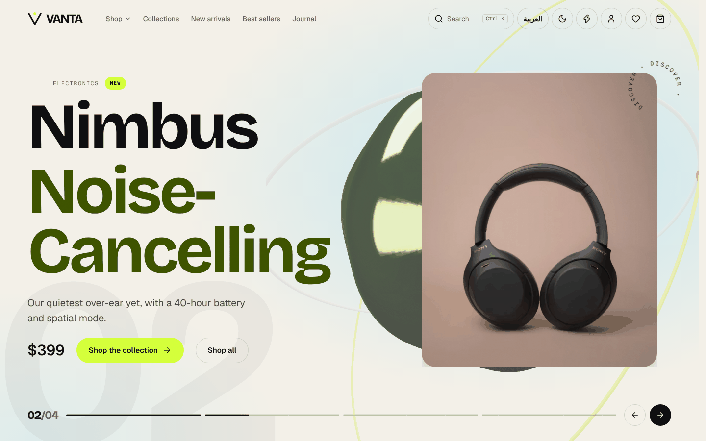
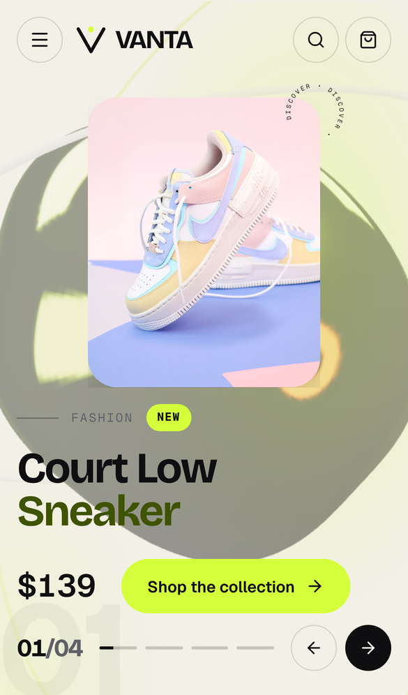

<div align="center">

# VANTA — Bilingual 3D Commerce Storefront

**A production-style Next.js 16 storefront with English / Arabic (RTL) routing, a WebGL hero, technical SEO built in, and a Playwright E2E suite running in CI.**

[](https://github.com/Eslamraafat1/E-commerce-New-/actions/workflows/e2e.yml)


[](https://e-commerce-new2-delta.vercel.app/en)

[**Live Demo**](https://e-commerce-new2-delta.vercel.app/en) · [**Portfolio**](https://new-portfolio-ashy-xi.vercel.app) · [**LinkedIn**](https://www.linkedin.com/in/eslamraafat-dev/)

<br />


&nbsp;


</div>

---

## Overview

VANTA is a **concept / demo store** I designed and built end to end to show how I approach a real e-commerce front end: a multi-category catalog (7 categories, 4 collections, 46 sample products), a full cart-to-checkout flow, customer account and admin screens, and every page available in **English and Arabic with a true RTL layout**.

It is not a client project and nothing is sold. All products, reviews and ratings are sample data, and orders, auth and payments run in an honest **Demo Mode**. The front end is still built against a typed API layer and a documented backend contract ([`docs/BACKEND_INTEGRATION.md`](docs/BACKEND_INTEGRATION.md)), so moving to a real backend means changing one environment variable, not rewriting components.

The problem it explores: **how to ship an immersive, animation-heavy storefront without giving up the things that actually make money: SEO, performance, accessibility and reliability.**

## Key Features

### Shopping flow
- Catalog with **URL-synced filters**, sorting, grid/list views, "load more", a mobile filter drawer, and skeleton, empty and error-with-retry states
- Product pages with **exact variant resolution** (size/colour → SKU, price, stock, image); unavailable options are marked `aria-disabled` and **Add to cart** stays locked until a variant is chosen
- Quick View modal, cart drawer, wishlist and recently viewed items
- Checkout with delivery methods, demo discount codes with explicit rules (`config/store.ts`) and an order confirmation page
- **Server-side re-pricing**: the demo `POST /api/orders` validates the payload with Zod and recomputes totals and stock from the catalog. Client prices are never trusted
- `Ctrl / Cmd + K` command palette for search, navigation and quick actions
- Demo account area (profile, addresses, orders) and admin screens (products, categories, collections, orders, settings)

### 3D & motion
- WebGL hero built with **React Three Fiber + Drei** (`MeshDistortMaterial`, `PerformanceMonitor`), **lazy-loaded with `next/dynamic` (`ssr: false`)**
- The 3D scene is **skipped automatically** on reduced-motion, Save-Data, low-memory / low-core devices, or when WebGL is unavailable
- GSAP + ScrollTrigger hero carousel, pinned horizontal showcase and scroll-linked sections, all wrapped in `gsap.matchMedia()` so they respect `prefers-reduced-motion`
- Framer Motion micro-interactions, a route-transition curtain, React `ViewTransition` on the product page and the View Transitions API for theme switching
- Lenis smooth scrolling, plus a **motion on/off toggle** in the header that is saved per visitor

### Internationalization & RTL
- Locale-prefixed routing (`/en/...`, `/ar/...`) for every page
- `proxy.ts` sends locale-less URLs to the right locale using a `vanta-locale` cookie, then the `Accept-Language` header
- `<html lang dir>` set per locale, with dedicated Arabic typography (IBM Plex Sans Arabic)
- Locale-aware currency, number and date formatting via `Intl`
- Typed dictionaries (`lib/i18n/en.ts`, `lib/i18n/ar.ts`) shared by server and client components

### Forms & validation
- **React Hook Form + Zod** (`@hookform/resolvers`) for checkout, login/register/forgot-password, profile and address forms, with localized error messages
- **Zod schemas also validate on the server** in the API route handlers (`lib/api/schemas.ts`)

### Accessibility
- Skip-to-content link and a focusable `<main>` landmark
- Reusable accessible dialog: portal, focus trap, focus restoration, `Escape` to close, scroll lock
- Variant pickers exposed as ARIA radio groups (covered by the E2E suite)
- Animated split-letter headings keep their accessible name
- Light / dark theme applied before first paint (no flash), following `prefers-color-scheme`

## Tech Stack

| Area | Tools |
|---|---|
| Framework | **Next.js 16.4.3** (App Router, Cache Components, Partial Prefetching, Turbopack), **React 19.3** |
| Language | **TypeScript 5** (`strict`) |
| Styling | **Tailwind CSS 4**, CSS custom-property design tokens, `next/font` (Geist, Bricolage Grotesque, IBM Plex Sans Arabic) |
| 3D | three 0.186, @react-three/fiber 9.8, @react-three/drei 10.7 |
| Motion | GSAP 3.15 (ScrollTrigger), Framer Motion 14.7, Lenis 1.3 |
| Forms & validation | React Hook Form 7.91, Zod 4.6, @hookform/resolvers 6 |
| State | `useSyncExternalStore` + localStorage persisted stores (no state library) |
| Icons | lucide-react |
| Testing | Playwright 1.48 (E2E), GitHub Actions CI |
| Quality | ESLint 9 (`eslint-config-next` core-web-vitals + TypeScript) |
| Hosting | Vercel |

## Architecture Highlights

- **Locale routing in `proxy.ts`.** Next.js 16 renamed Middleware to Proxy. Every page lives under `app/[locale]/`, `generateStaticParams` pre-renders both locales, and unknown locales return `notFound()`.
- **A single data layer (`lib/api/*`).** UI components never contain URLs. A typed `apiFetch` wrapper handles the `{ data, meta }` / `{ error }` envelope, typed `ApiError`s and `AbortController` cancellation. `NEXT_PUBLIC_USE_DEMO_API` switches between the built-in Route Handlers (`app/api/*`, backed by `data/demo/*`) and a real backend at `NEXT_PUBLIC_API_BASE_URL`.
- **A documented backend contract.** Endpoints, query params, response shapes and what must be replaced before production are listed in [`docs/BACKEND_INTEGRATION.md`](docs/BACKEND_INTEGRATION.md).
- **Small persisted stores (`lib/persisted-store.ts`).** Cart, wishlist, recently viewed, discount and delivery state use `useSyncExternalStore` with a deterministic server snapshot, so hydration never mismatches. They also stay in sync across tabs through the `storage` event.
- **Client-only URL state for filters.** `history.replaceState`, which Next.js integrates with `useSearchParams`, keeps filters shareable without a server round-trip.
- **Central store config (`config/store.ts`).** Brand, currency, locales, shipping rules, return window and discount codes are defined in one place.
- **Prices in integer minor units** end to end, which avoids floating-point rounding errors.

## SEO & Performance

What the code actually implements:

| Technique | Where |
|---|---|
| Metadata API with title template, description, Open Graph and Twitter cards (`summary_large_image`) on every page | `app/[locale]/layout.tsx`, `lib/page.ts` (`pageMeta`) |
| Per-page **absolute canonical URLs + `hreflang` alternates** (`en` / `ar` / `x-default`) | `lib/page.ts` (`pageMeta`) |
| **Site URL that can never resolve to localhost in production**: `NEXT_PUBLIC_SITE_URL` → Vercel production domain → hard-coded production URL | `config/store.ts` (`resolveSiteUrl`) |
| **Branded Open Graph / Twitter image** generated at build time with `ImageResponse` (1200×630, per locale) | `app/[locale]/opengraph-image.tsx`, `twitter-image.tsx` |
| **JSON-LD**: `Organization` + `WebSite` with `SearchAction` (home), `Product` with `AggregateOffer` and availability (product pages), `BreadcrumbList` (product and category pages), all escaped against `</script>` injection | `lib/seo.ts`, page files |
| Product-specific Open Graph images (product photo) | product `generateMetadata` |
| Dynamic **`sitemap.xml`** covering every static page, category, collection, article and product in both locales, with `xhtml:link` hreflang alternates | `app/sitemap.ts` |
| **`robots.txt`** that blocks `/api/`, cart, checkout, account, admin and order confirmation | `app/robots.ts` |
| `noindex` on private and utility pages (account, search, recently viewed, auth) | `pageMeta(..., noindex = true)` |
| Static generation of every product page through `generateStaticParams` | products, categories, collections, journal |
| `next/image` with AVIF/WebP and restricted quality levels, plus a fallback for images that fail to load | `next.config.ts`, `components/ui/smart-image.tsx` |
| Heavy client components code-split with `next/dynamic` (3D scene, Quick View, cart drawer, command palette) | `components/home/hero.tsx`, `components/providers/ui.tsx` |
| `next/font` self-hosted fonts with `display: swap` and a per-locale font stack | `app/[locale]/layout.tsx` |
| Responsive `viewport` and `themeColor` for light and dark | `app/[locale]/layout.tsx` |
| Real HTTP **404** for unknown routes (catch-all `[...rest]` → `notFound()`) and for unknown product / category / collection / article / policy slugs (checked in `proxy.ts` before streaming starts, so they are not "soft 404s") | `app/[locale]/[...rest]/page.tsx`, `proxy.ts` |

Sample ratings are shown in the UI but deliberately **not** emitted as `AggregateRating` structured data, because Google requires review markup to reflect genuine reviews.

## Testing & QA

### Automated: Playwright E2E
The suite in [`e2e/`](e2e) runs in **two projects, Desktop Chrome and Mobile Chrome (Pixel 7)**. It has **31 tests**: 19 user-flow and smoke tests run on both viewports and 12 SEO tests run once (they are viewport-independent), so a full run is **62 test runs: 50 executed, 12 skipped by design**.

| Spec | What is asserted |
|---|---|
| `checkout.spec.js` | **Add to cart → header count → cart totals → checkout → demo order.** Size must be chosen; the cart button's accessible name goes `Cart (0)` → `Cart (1)` → `Cart (2)`; subtotal / shipping / total are checked, including the free-shipping threshold; an invalid discount code is rejected and `VANTA10` takes 10% off. Checkout submits empty, invalid-email, invalid-phone and too-short-address values and asserts the **Zod error messages** and `aria-invalid`, then completes all five steps, places the demo order (re-priced by `POST /api/orders`), lands on the confirmation page and the cart is emptied |
| `catalog.spec.js` | Browse from the categories index into a category; **sorting** by price writes `?sort=` to the URL and the visible prices are in order; a **price filter** writes `?max=` to the URL, narrows the result count, survives a reload and can be removed (desktop sidebar and mobile filter drawer) |
| `i18n-a11y.spec.js` | **Language switch EN → AR** keeps the page, sets `lang="ar"` `dir="rtl"`, shows Arabic content and is remembered by the locale redirect; **theme toggle** flips and persists `data-theme`; unknown pages and unknown product slugs return HTTP **404** with the localized 404 page |
| `seo.spec.js` | On `/en`, `/ar`, shop, category and product pages: canonical, `hreflang` (en / ar / x-default), `og:url` and `og:image` are **absolute https URLs and never localhost**; Twitter card type; JSON-LD parses and contains `WebSite` + `SearchAction`, `Product` with an offer, and `BreadcrumbList`; the OG image is a generated PNG; `robots.txt` blocks private areas and points to an absolute sitemap; `sitemap.xml` lists 100+ URLs in both locales with hreflang alternates; private pages are `noindex` |
| `smoke.spec.js` | Home in both locales (`lang`/`dir`), skip link, shop and category headings, product title, Add to cart locked until a size is picked, 404 for unknown routes |

Tests use role- and accessible-name-based locators (`getByRole`, `getByLabel`) rather than brittle CSS selectors, and wait on real UI state instead of fixed timeouts.

**CI:** [`.github/workflows/e2e.yml`](.github/workflows/e2e.yml) runs on every push to `main`, on every pull request and on manual dispatch (Node 22, Chromium): `npm ci` → **lint** → **production build** → `npm start` → the full E2E suite **against that local build**. Failed tests are retried twice with traces on the first retry, and the HTML report is uploaded as a build artifact for 14 days.

```bash
npm install && npm run build && npm start   # terminal 1: local production build
cd e2e && npm ci && npx playwright install chromium
BASE_URL=http://localhost:3000 npm test     # terminal 2: against the local build
npm test                                    # against the live site (default BASE_URL)
npm run report                              # open the HTML report
```

From the repository root, `npm test` (alias of `npm run test:e2e`) runs the same suite.

### Manual QA
According to [`IMPLEMENTATION_STATUS.md`](IMPLEMENTATION_STATUS.md), the app was also checked by hand: a responsive sweep of 40 routes × 2 locales at 9 widths (320 to 1920 px) looking for horizontal overflow and JS errors, plus walkthroughs of filters, quick view focus handling, the variant → SKU/image mapping, discount codes, checkout validation and the language and theme switches. That file also lists the known limitations.

## Project Structure

```text
.
├── app/
│   ├── [locale]/            # All pages, in /en and /ar (35 routes: shop, PDP, cart, checkout, account, admin…)
│   │   ├── layout.tsx       # <html lang dir>, fonts, metadata, providers
│   │   └── [...rest]/       # Catch-all → real 404
│   ├── api/                 # Demo Route Handlers: products, categories, collections, search, orders, contact
│   ├── [locale]/opengraph-image.tsx  # Generated social share image
│   ├── sitemap.ts           # Multilingual sitemap with hreflang
│   └── robots.ts
├── components/
│   ├── home/                # Hero (+ lazy R3F scene) and homepage sections
│   ├── shop/                # Catalog, PDP, variants, quick view, cart, checkout
│   ├── layout/              # Header, mega menu, command palette, footer
│   ├── motion/              # GSAP setup, page curtain, motion primitives
│   ├── providers/           # i18n, UI (modals, shortcuts), smooth scroll
│   ├── account/ admin/      # Demo account and admin screens
│   └── ui/                  # Accessible dialog, smart image, FAQ, page header
├── lib/
│   ├── api/                 # Typed client, Zod schemas, errors, cart/pricing logic
│   ├── i18n/                # en / ar dictionaries
│   ├── seo.ts               # JSON-LD builders, absolute URLs, shared Open Graph fields
│   └── persisted-store.ts   # useSyncExternalStore + localStorage
├── config/store.ts          # Brand, locales, currency, shipping, discount rules
├── data/demo/               # Sample catalog (products, categories, journal)
├── e2e/                     # Playwright suite (flows, SEO, i18n, smoke) + config
├── docs/                    # Backend integration guide, screenshots
├── proxy.ts                 # Locale detection/redirect + real 404 for unknown slugs
└── next.config.ts           # Cache Components, image formats, Turbopack
```

## Getting Started

**Prerequisites:** Node.js 20.9 or newer (`engines` in `package.json`; CI runs Node 22) and npm.

```bash
git clone https://github.com/Eslamraafat1/E-commerce-New-.git
cd E-commerce-New-
npm install
cp .env.example .env.local
npm run dev
```

Open http://localhost:3000. You will be redirected to `/en` or `/ar`.

### Environment variables

| Variable | Default in `.env.example` | Purpose |
|---|---|---|
| `NEXT_PUBLIC_USE_DEMO_API` | `true` | `true` uses the built-in demo API (`/api/*`); `false` uses your backend |
| `NEXT_PUBLIC_API_BASE_URL` | `http://localhost:8000/api` | Real backend base URL (example value only) |
| `NEXT_PUBLIC_SITE_URL` | *(empty)* | Optional absolute URL for canonical links, hreflang, Open Graph, JSON-LD, sitemap and robots. When empty, Vercel's production domain is used, then `https://e-commerce-new2-delta.vercel.app`. Never localhost |

### Scripts

| Command | Description |
|---|---|
| `npm run dev` | Start the dev server (Turbopack) |
| `npm run build` | Production build |
| `npm run start` | Serve the production build |
| `npm run lint` | Run ESLint |
| `npm run typecheck` | Type-check with `tsc --noEmit` |
| `npm test` / `npm run test:e2e` | Run the Playwright E2E suite (install it first with `cd e2e && npm ci`) |

## Deployment

The app is deployed on **Vercel**: https://e-commerce-new2-delta.vercel.app/en

To deploy your own copy, import the repository into Vercel (it detects Next.js automatically) and set the environment variables above. Canonical URLs, hreflang links and the sitemap use `NEXT_PUBLIC_SITE_URL` if set, otherwise Vercel's production domain, so they never fall back to localhost; set it explicitly when you use a custom domain. Before handling real customers, replace demo auth, payments and persistence as described in [`docs/BACKEND_INTEGRATION.md`](docs/BACKEND_INTEGRATION.md).

## License

[MIT](LICENSE) © 2026 Eslam Raafat. Product photography is loaded from Unsplash and remains subject to the Unsplash License.

<!-- more-projects:start -->
## More of my work

| Project | What it is | Demo |
|---|---|---|
| **[Atlas Estates](https://github.com/Eslamraafat1/New-Real-Estate)** | 3D real estate platform | [Live](https://new-real-estate-jade.vercel.app) |
| **[Crust & Crave](https://github.com/Eslamraafat1/New-Restaurant)** | cinematic restaurant storefront | [Live](https://new-restaurant-kappa.vercel.app) |
| **[NEXORA Academy](https://github.com/Eslamraafat1/Courses-N)** | bilingual e-learning platform | [Live](https://courses-n.vercel.app) |
| **[Nubia](https://github.com/Eslamraafat1/Perfume)** | perfume store on Supabase | [Live](https://perfume-sooty-alpha.vercel.app) |
| **[MONOLITH](https://github.com/Eslamraafat1/3D-Website-)** | 3D architecture studio site | [Live](https://3-d-website-seven-xi.vercel.app) |
| **[Tour Egypt Club](https://github.com/Eslamraafat1/Travel)** | client travel & tours website | [Live](https://touregyptclub.com) |
| **[Portfolio](https://github.com/Eslamraafat1/new-portfolio)** | bilingual Next.js portfolio | [Live](https://new-portfolio-ashy-xi.vercel.app) |

**More client & personal work:** [The Untold Story](https://github.com/Eslamraafat1/Advertising) · [Harvest British College](https://github.com/Eslamraafat1/HarvestNew) · [Namaa](https://github.com/Eslamraafat1/Namaa) · [Physical therapy clinic](https://github.com/Eslamraafat1/Physical-therapy) · [Cord Academy](https://github.com/Eslamraafat1/Cord-academy) · [EVAY cars](https://github.com/Eslamraafat1/Car) · [VISTRA VR mall](https://github.com/Eslamraafat1/VR-Website) · [Prayer times](https://github.com/Eslamraafat1/Prayer-time)

See everything on my [GitHub profile](https://github.com/Eslamraafat1) and [portfolio](https://new-portfolio-ashy-xi.vercel.app/).
<!-- more-projects:end -->

## Author

**Eslam Raafat** — Front-End Developer (React · Next.js · TypeScript)
Technical SEO · Web performance · Manual & automated QA · Bilingual EN/AR (RTL) interfaces

- Portfolio: [new-portfolio-ashy-xi.vercel.app](https://new-portfolio-ashy-xi.vercel.app)
- LinkedIn: [linkedin.com/in/eslamraafat-dev](https://www.linkedin.com/in/eslamraafat-dev/)
- GitHub: [@Eslamraafat1](https://github.com/Eslamraafat1)
- Email: [eslamraafat736@gmail.com](mailto:eslamraafat736@gmail.com)

> Open to Front-End Developer roles. If you're hiring, I'd be glad to talk.
